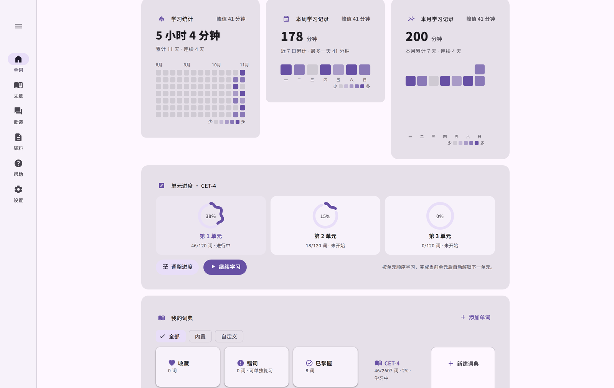

<h1 align=center>
  
</h1>

  <a href="/README.md">English</a> |
  <a href="/docs/README.es.md">Español</a> |
  <a href="/docs/README.de.md">Deutsch</a> |
  <a href="/docs/README.fr.md">Français</a> |
  <a href="/docs/README.pt.md">Português</a> |
  <a href="/docs/README.ru.md">Русский</a> |
  <a href="/docs/README.uk.md">Українська</a> |
  <a href="/docs/README.ja.md">日本語</a> |
  <a href="/docs/README.ko.md">한국인</a> |
  <a href="/docs/README.th.md">ไทย</a> |
  <a href="/docs/README.vi.md">Tiếng Việt</a> |
  <a href="/docs/README.id.md">Bahasa Indonesia</a> |
  <a href="/docs/README.zh-TW.md">繁體中文</a> |
  <a href="/docs/README.zh-CN.md">简体中文</a> 

  <b>Learn English, one keystroke at a time; smarter memorization, more efficient learning - an open-source word and article practice tool</b>

## Project Introduction

<https://www.bilibili.com/video/BV1QwYv6eEAS>

## Online Access

<https://typewords-dws.pages.dev>

This fork is deployed as a static site on Cloudflare Pages (built from this repository's `master` branch). The server-side `/api/word` and `/api/translate` proxy routes are not bundled in the static deployment, so the online dictionary lookup and translation features fall back to whatever the client already stores locally.

## Fork Enhancements (Material 3 Expressive Dashboard)

This repository is a fork of [zyronon/TypeWords](https://github.com/zyronon/TypeWords). On top of the original project, this fork adds a Material 3 Expressive (M3E) UI layer, a learning dashboard, and dictionary-unit management.

### Dashboard

- `/words` serves the new M3E dashboard, `/dashboard` is kept as a comparison entry, and `/words-classic` preserves the previous home page.
- Built with the `mtrl` and `sober` web component libraries, with light/dark themes bridged through `app/assets/css/m3e-tokens.scss`.
- Today task card: minutes learned today **and** the number of new words learned today, a wavy linear progress bar (today's new words / effective daily goal), a running/completed status chip, a start-review action, and the random-review switch.
- Daily goal: a fixed per-dictionary goal plus a **today-only temporary goal** (`临时修改`, with a `临时` badge and a restore action). Saving either goal invalidates the pending practice session so the new goal takes effect immediately.
- Unit progress: cards and rings with circular wavy progress, unit names rendered through `useUnitLabel()` (`Unit {name}` / `单元 {name}`), plus dialogs to adjust unit progress and pick which words of a unit to practice.
- Statistics: KPI overview with dictionary / current-unit scope switching, heatmap study calendar (click a day to open its study records), and 7-day bar chart.
- My dictionaries card with all / built-in / custom segmented filtering, quick join for recommended dictionaries, and the word-import entry.

### WebDAV Cloud Sync

- **Replaces the previous Supabase integration.** Sync now targets any WebDAV drive you own, so there is no backend to deploy and no third-party account beyond your own cloud storage.
- Providers: 坚果云 (Nutstore), InfiniCLOUD, Nextcloud, ownCloud, Synology DSM, QNAP, pCloud, Yandex Disk, Koofr and 123云盘, plus a custom/self-hosted option. Choosing a provider fills in the WebDAV root URL automatically.
- Data is written to `{WebDAV root}/{folder}/data.json` (folder defaults to `typewords-data`, editable in the settings page; renaming it triggers a sync so nothing is lost).
- **Merge, never clobber:** every sync first pulls the remote snapshot and merges it into the local archive — dictionaries only present remotely are appended, and for dictionaries on both sides the words, units, study records, FSRS cards, notes and progress are unioned/compared, with local data winning on conflicts. The merged result is then written back over the remote file.
- Sync triggers: opening the site, entering `/words` (including the sidebar word button), and finishing a study or review round. A circular button at the right of the dashboard header shows the state: plain sync icon (not configured or never synced), spinning (syncing), green check (success), yellow exclamation (bad URL / wrong credentials / network error).
- Transport: requests go through a same-origin `/api/webdav` proxy (`server/api/webdav.post.ts`, or `functions/api/webdav.js` on Cloudflare Pages) because WebDAV servers rarely send CORS headers; static deployments without the proxy fall back to direct browser requests.
- Supabase code is no longer used at runtime (`app/core/utils/supabase.ts` is kept only as dead code); the old `supabase_config` key is removed on startup.

### New Pages and Utilities

- `/dict-units/[id]`: dictionary unit detail page (create units, pick member words, adjust progress, switch study mode).
- `/import-words`: word import page supporting multiple input formats and unit headings.
- `app/core/utils/dict-units.ts`: unit splitting, unit progress offsets, and unit-pointer synchronisation.
- `app/core/utils/daily-goal.ts`: effective daily goal resolution (temporary goal → dictionary goal) shared by every task builder.
- `app/core/composables/useUnitLabel.ts`: unified unit-name rendering.
- `server/api/word.get.ts` and `server/api/translate.get.ts`: local dictionary and translation API routes.

### Recent Fixes

- **Temporary daily goal is now persisted.** `getDefaultDict()` gained `tempPerDayNumber` / `tempPerDayDate` placeholder keys. The archive normaliser only copies keys that exist in the default dictionary, so the temporary goal used to be silently dropped on every reload (and on remote pulls).
- **Official dictionaries are re-fetched on the dashboard.** Official word lists are not stored in the archive, so after a refresh the dashboard now hydrates them once the global archive is loaded (mirroring `words-classic.init()`). The card, the unit rings and the start button no longer report "no words to learn", and a failed fetch degrades to an honest message instead of a blank task.
- **Dictionary ids are compared type-agnostically.** Official resource ids can be numbers while route params are strings; `isDictIdMatch()` is now used when resolving the dictionary on the practice page, fixing a silent redirect back to `/words`.
- **The start button no longer inherits the review mode.** `wordPracticeMode` is a persisted global setting, and clicking *start review* used to leave it at `Review`, so the study button kept opening the review flow. The dashboard now normalises session-scoped modes back to `System`, drops a pending session that belongs to another flow, and clears stale route data.
- **Zero-goal guard.** A stored goal of `0` falls back to the dictionary goal (and finally to `20`), and the goal dialog never saves less than one word.

### Other

- i18n keys completed for all 14 locales, including the dashboard, unit and daily-goal strings (`m3e_*`).
- `Cache-Control: no-cache` response headers for `/words`, `/articles`, `/setting` and `/dashboard` to avoid stale pages after a release.
- Added dependencies: `mtrl ^0.10.8`, `sober ^1.1.10`.

### 中文说明

- 本仓库是 [TypeWords](https://github.com/zyronon/TypeWords) 的 fork，在原有功能之上新增了 Material 3 Expressive 风格的仪表盘、学习统计与词典单元管理。
- `/words` 为新的 M3E 仪表盘首页，`/dashboard` 作为对照入口，`/words-classic` 保留旧版首页。
- 今日任务卡：同时显示「今日已学分钟数」与「今日已学单词数」，波浪线性进度条按「今日新学词数 / 生效的每日目标」计算，另有进行中/已完成状态、开始复习与随机复习开关。
- 每日目标：词典固定目标 + 仅今天生效的「临时修改」（带「临时」徽章、可恢复默认）；保存目标会作废未完成的旧任务，保证新目标立即生效。
- 单元进度：卡片与环形进度，单元名统一由 `useUnitLabel()` 渲染（`Unit {name}` / `单元 {name}`），支持调整进度、挑选本单元练习单词。
- 统计区：支持词典 / 当前单元口径切换，包含网格热力日历（点击某天可查看当天学习记录）与近 7 日学习柱状图；「我的词典」支持全部/内置/自定义分段筛选与导入入口。
- 新增词典单元详情页 `/dict-units/[id]`、单词导入页 `/import-words`（支持单元标题）、单元进度工具 `app/core/utils/dict-units.ts`、有效每日目标工具 `app/core/utils/daily-goal.ts`、单元名渲染 `app/core/composables/useUnitLabel.ts`，以及本地词典 / 翻译接口。
- 本 fork 修复：临时目标刷新后丢失；官方词典刷新后误报「没有单词可学习」；词典 id 数字/字符串比较导致点开始静默跳回；开始按钮沿用上次的复习模式；目标为 0 导致任务恒空。
- **云同步已从 Supabase 改为 WebDAV**：数据写到 `{WebDAV 根地址}/{目录}/data.json`（目录默认 `typewords-data`，可在设置页改，改完自动同步一次）。每次同步先拉远端、以合并方式覆盖本地（远端独有词典整本追加；两边都有的词典按单词/单元/学习记录/FSRS/笔记/进度取并集或较新值，冲突时本地优先），再把合并后的完整数据覆盖回远端。同步时机：打开站点、进入 `/words`、学习或复习一轮结束；主页页头最右侧的圆形按钮显示「未配置/同步中/成功/失败」四态。设置页可选坚果云、InfiniCLOUD、Nextcloud、ownCloud、群晖、威联通、pCloud、Yandex、Koofr、123云盘或自定义地址。浏览器直连第三方 WebDAV 会被 CORS 拦截，因此走同源 `/api/webdav` 代理（本地 Node 版 `server/api/webdav.post.ts`，Cloudflare Pages 用 `functions/api/webdav.js`）。

## Features

### Word Practice

- Practice modes: Follow-along / Dictation / Self-test / Spelling from memory
- Smart mode: Automatically calculates learning words based on memory curves, deepening memory through dictation
- Free mode: No restrictions, plan your own learning
- Provides phonetics, pronunciation (American/British), example sentences, phrases, synonyms, root words, etymology, error statistics, and more

### Article Memorization

- Built-in classic textbooks; you can also add or import articles with one-click translation and bilingual comparison
- Follow-along + dictation dual modes, sentence-by-sentence input with automatic pronunciation for more efficient memorization
- Supports listening while writing from memory to reinforce learning

### Favorites, Wrong Words, Mastered

- Words typed incorrectly while learning are automatically added to your wrong word book for later review
- Actively add words to mastered to automatically skip them in future sessions
- Add words to favorites for consolidation and review

### Highly Customizable

- Rich keyboard sound effects
- Customizable shortcuts
- Highly configurable settings

### Clean and Efficient

- Clean design, modern UI, ad-free
- Refreshing interface, simple operation
- No forced subscription to any platform

### Vocabulary Library

Built-in commonly used vocabulary including CET-4, CET-6, GMAT, GRE, IELTS, SAT, TOEFL, Graduate English, TEM-4, TEM-8, and more (official website only).
Designed to meet most users' vocabulary learning needs. Community contributions of additional vocabulary are welcome.

## Running the Project

#### Note: This project can run standalone with data saved locally. Manual backup is required when switching devices; this does not affect normal usage.

This project is built with `Nuxt` and requires a Node.js environment.

1. Install NodeJS, refer to the [official documentation](https://nodejs.org/en/download)
2. The project is large. It's recommended to use `git clone --depth 1 https://github.com/zyronon/TypeWords.git` to clone only the latest commit. GitHub's Download ZIP feature will not work properly.
3. In the project root directory, open a terminal and run `pnpm install` to download dependencies.
4. Run `pnpm run dev` to start the project. The default address is [`http://localhost:5567`](http://localhost:5567)
5. Open [`http://localhost:5567`](http://localhost:5567) in your browser to access the project.
6. Run `pnpm run generate` to build the project files.

## Features and Suggestions

The project is currently in early development, with new features being added continuously. If you have any suggestions or feature requests, feel free to open an `Issue`.
If you like the design philosophy of this software, please submit a `PR`. Thank you for your support!

## Contributing Guide

[Contributing Guidelines](/docs/CONTRIBUTING.md)

If you're interested in this project, we welcome your contributions and will provide as much help as possible.

Before contributing, please communicate with the developers to avoid code conflicts.

Thank you again for your contributions!
